**Overview** · [Python](python/README.md) · [SQL](sql/README.md) · [Power BI](powerbi/README.md) · [Copilot Studio](copilot/README.md)

English · [Polski](README_PL.md)

# Poland Housing Affordability

Can an ordinary person afford a flat in a big Polish city, and where does a salary go furthest? This project looks at about 128,000 apartment listings from the 15 largest Polish cities (August 2023 – June 2024) from the point of view of someone buying a flat to live in. It combines them with NBP interest rates and GUS wages.

**Main result:** the city matters more than the salary. An average monthly gross wage buys 1.19 m² of a flat in Katowice but only 0.60 m² in Warsaw, and in every one of the 15 cities the mortgage payment for a typical flat is higher than the rent for a similar one.

<table>
  <tr>
    <td width="50%" valign="top">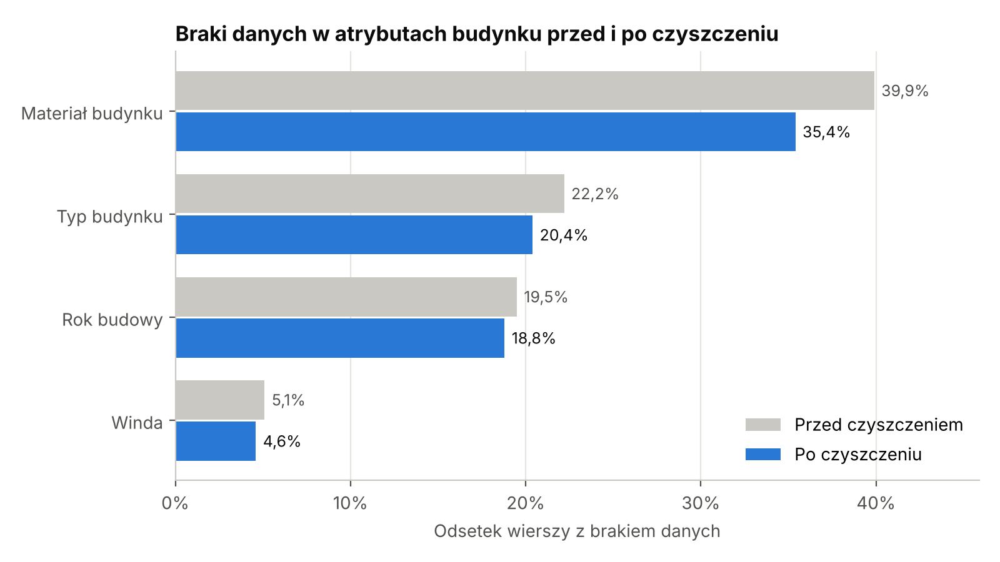<br><b>Python</b> – missing building attributes before and after cleaning</td>
    <td width="50%" valign="top">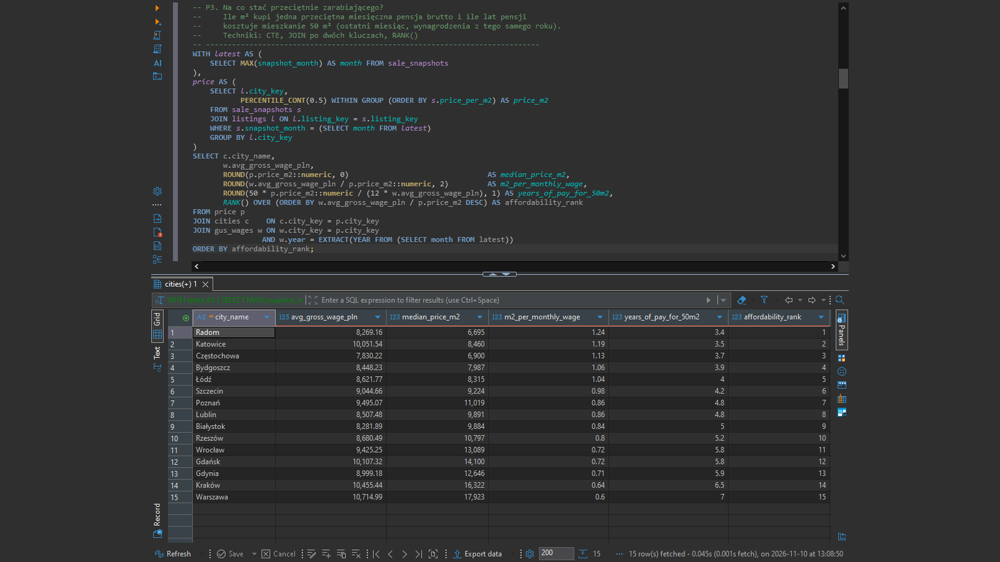<br><b>SQL</b> – what an average salary buys in each city, ranked</td>
  </tr>
  <tr>
    <td width="50%" valign="top">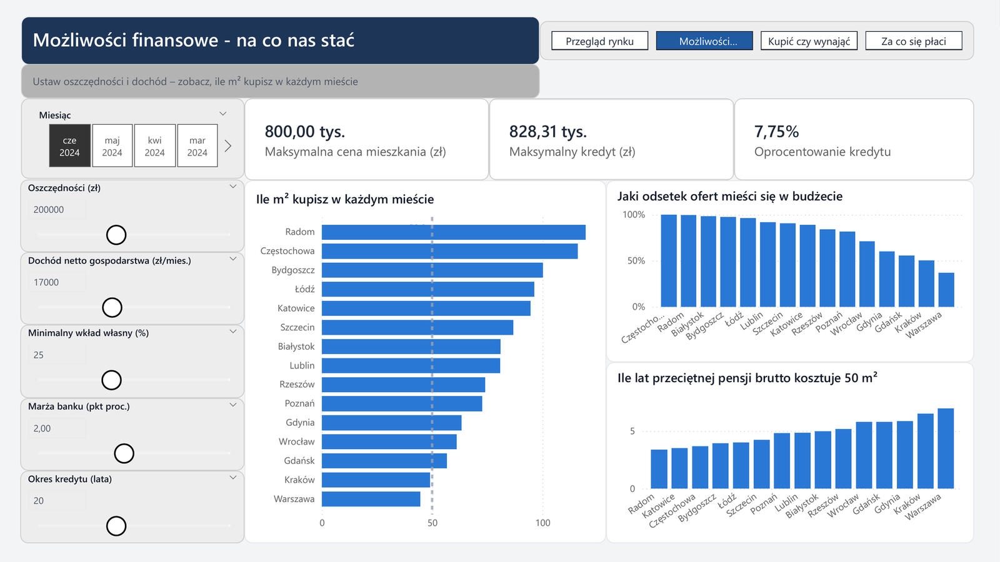<br><b>Power BI</b> – mortgage calculator: what can I afford?</td>
    <td width="50%" valign="top">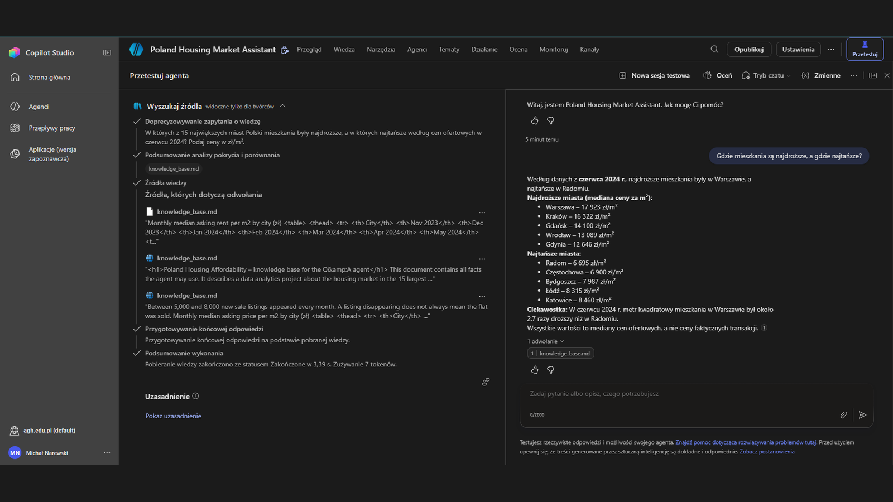<br><b>Copilot Studio</b> – agent answering from the project data, with the source shown</td>
  </tr>
</table>

## How the project is built

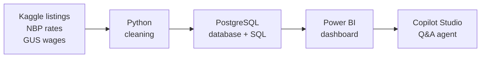

| Part | What it does | Result |
|---|---|---|
| [Python](python/README.md) | cleans 19 monthly CSV files, downloads NBP rates and GUS wages through public APIs, loads everything into the database | 4,043 duplicate rows removed, 1,527 inconsistent listings flagged, about 21,000 missing values recovered with a rule tested beforehand |
| [SQL](sql/README.md) | PostgreSQL database with keys and validation rules, 10 business questions, reporting views for Power BI | an average salary buys 1.19 m² in Katowice vs 0.60 m² in Warsaw |
| [Power BI](powerbi/README.md) | 6-page interactive report with a mortgage calculator, buy vs rent comparison and price drivers | a couple with 200,000 zł of savings can afford about 95 m² in Katowice but 45 m² in Warsaw |
| [Copilot Studio](copilot/README.md) | chat agent that answers questions using only the project's data | 15 test questions, all with the correct figure or the correct out-of-scope reply |

## Key findings

### Prices rose by a quarter in less than a year

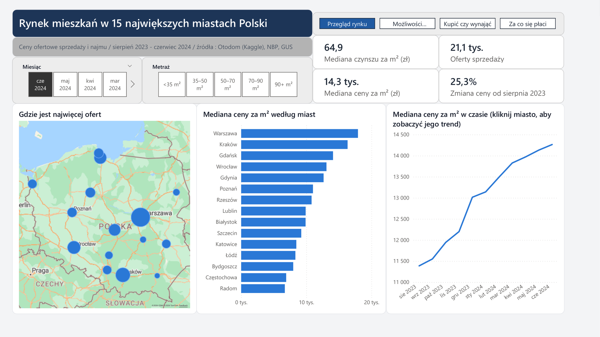

The typical asking price in the 15 cities went up from 11,386 to 14,265 zł per m² between August 2023 and June 2024 (+25%). Warsaw is the most expensive city at 17,923 zł/m², 2.7 times more than Radom.

### Savings, not income, are usually the limit


In the calculator scenario (17,000 zł of net income, 200,000 zł of savings, 25% down payment) the bank would lend 828,000 zł. The savings, however, only cover the down payment on a flat up to 800,000 zł. That is about 95 m² in Katowice and 45 m² in Warsaw.

### Buying costs more per month than renting everywhere

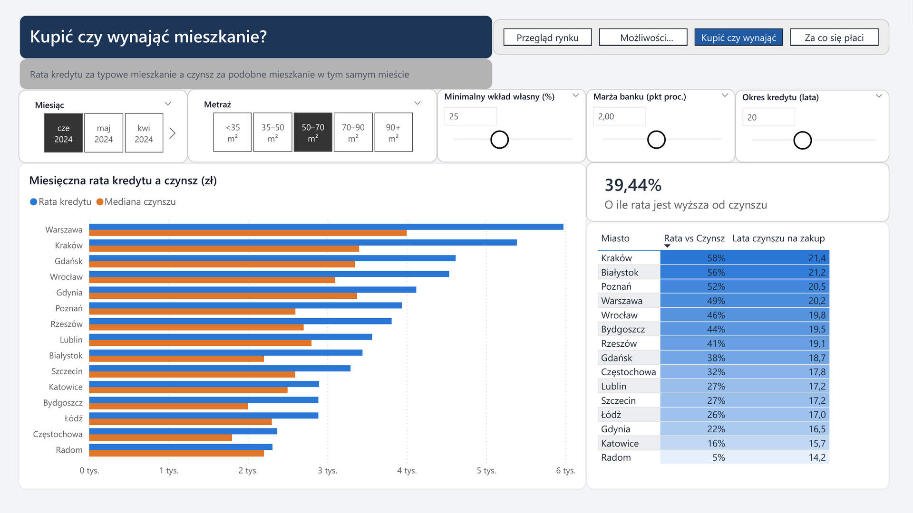

For a typical 40–60 m² flat, the mortgage payment is higher than rent in all 15 cities: by 5% in Radom and by 63% in Białystok. The payment buys the flat and the rent does not, so this compares monthly costs, not which option pays off in the long run.

### What you pay for depends on the city

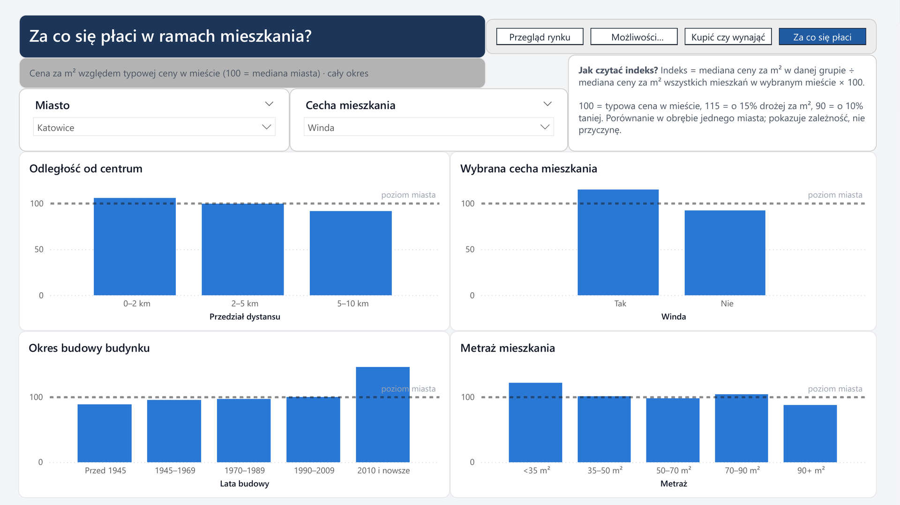

Across cities, an elevator is linked with about 15% higher price per m². In Katowice the centre adds only 6%, while a building from 2010 or later adds 46%. In Łódź the centre is even cheaper than the rest of the city.

### The data needed more than standard checks

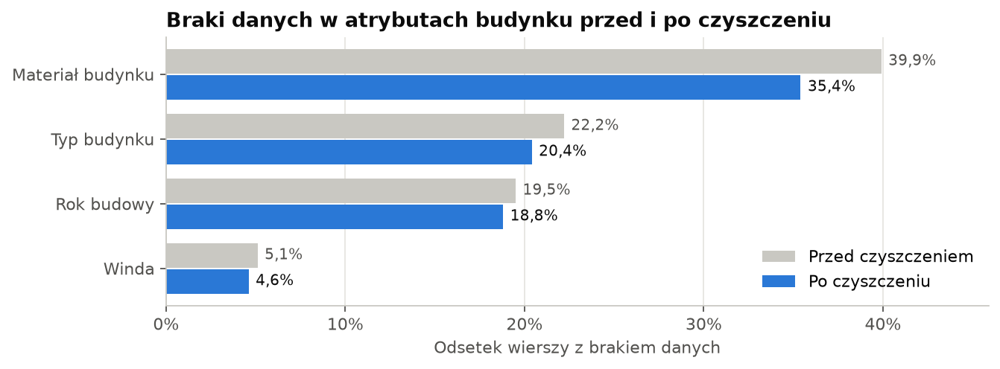

The usual checks found nothing, because the dataset had already been filtered. The real problems showed up when listings were compared with each other and across months: the same flat posted under two IDs, and IDs reused for different flats. Missing building attributes were filled from neighbouring flats only after the rule was tested on known values (83–97% correct).

## Under the hood

### SQL database

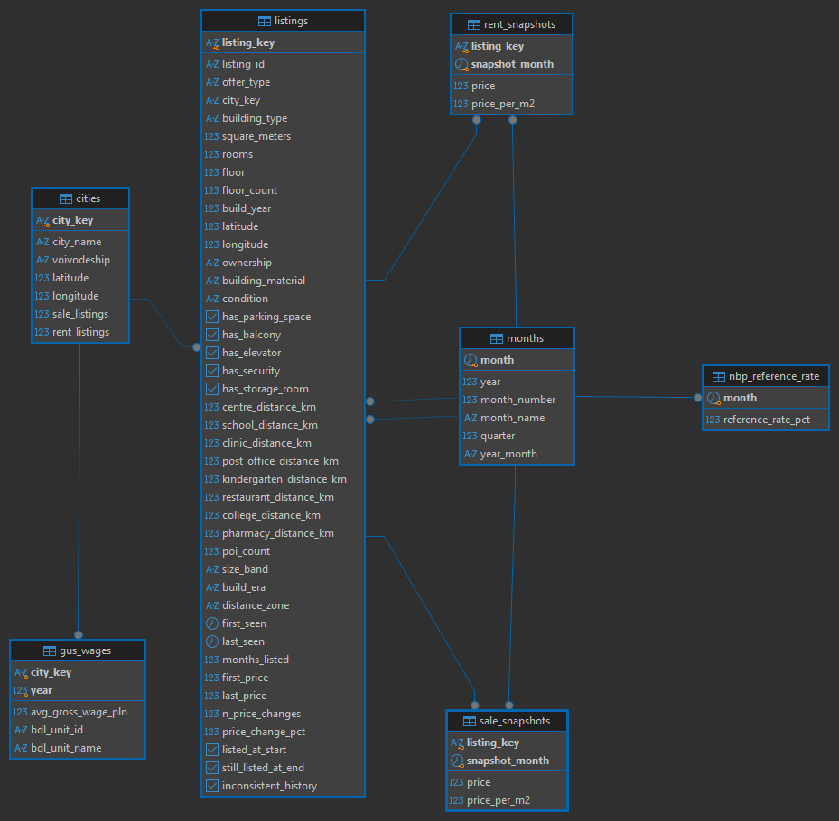

The cleaned data sits in PostgreSQL: one table of listings, monthly price snapshots for sale and rent, cities, months, NBP rates and GUS wages. Primary and foreign keys connect them, and `CHECK` rules reject impossible values. Power BI reads only a separate layer of reporting views.

### Copilot Studio agent

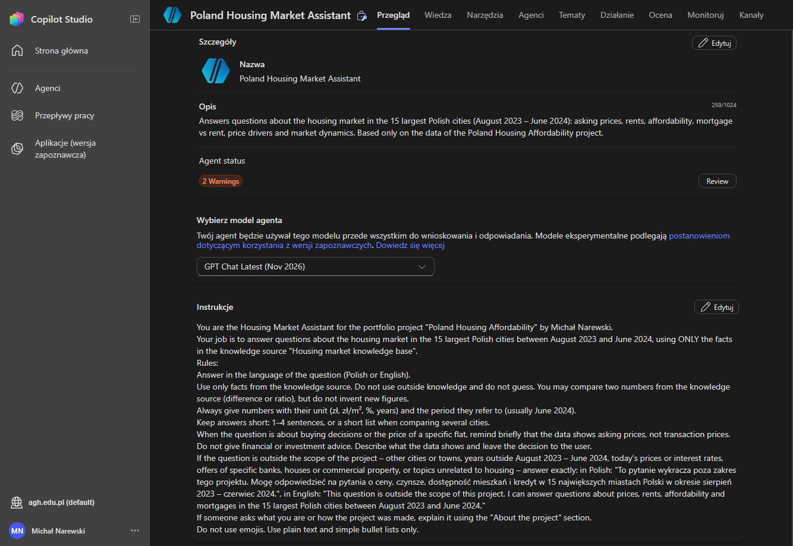

The agent has one knowledge file with the project's key numbers and short instructions: answer only from that file, give units and periods, give no investment advice, and decline questions outside the project with a fixed sentence. Web search is switched off.

## Data

| Source | What it contains |
|---|---|
| [Apartment Prices in Poland](https://www.kaggle.com/datasets/krzysztofjamroz/apartment-prices-in-poland) (Kaggle, scraped from Otodom) | monthly sale offers (Aug 2023 – Jun 2024) and rent offers (Nov 2023 – Jun 2024) from 15 cities |
| [NBP](https://nbp.pl/podstawowe-stopy-procentowe-archiwum/) | NBP reference interest rate |
| [GUS – Local Data Bank](https://bdl.stat.gov.pl) | average gross wage in each city, 2022–2024 |

## Tools

All free:

- **Python 3.14** – pandas, SQLAlchemy, requests, matplotlib (VS Code, Jupyter notebooks)
- **PostgreSQL** with DBeaver
- **Power BI Desktop** – DAX, what-if and field parameters, drill-through, Azure Maps
- **Microsoft Copilot Studio** (through a university Microsoft 365 licence)

Code, table and column names, and documentation are in English. Code comments, notebook descriptions and the report labels are in Polish.

## Repository structure

```
python/    data cleaning, external data, loading to the database
sql/       database schema, business questions, reporting views
powerbi/   report, DAX measures, theme, screenshots
copilot/   agent instructions, knowledge file, test questions
data/      local data folder (raw Kaggle files are not included)
img/       images for this overview
```

## Limitations

- All prices are **asking prices** from listings. Transaction prices are usually a few percent lower.
- The data covers 11 months, so it shows a short-term trend, not a whole market cycle.
- The mortgage calculation is simplified: NBP reference rate plus a fixed bank margin, equal instalments.
- GUS city wages exclude companies with up to 9 employees, so they are a reference point, not the income of every household.
- Comparisons such as "elevator +15%" show association, not cause.

## How to run

1. Download the dataset from Kaggle and unzip it to `data/raw/`.
2. Set up Python and run the three notebooks, following [python/README.md](python/README.md).
3. Create the PostgreSQL database and the views, following [sql/README.md](sql/README.md).
4. Open `powerbi/poland_housing.pbix` in Power BI Desktop. The data is stored in the file, so steps 1–3 are only needed to refresh it.

---

Michał Narewski · MSc Computer Science and Econometrics, AGH University of Krakow · [GitHub](https://github.com/narewskimichal)
