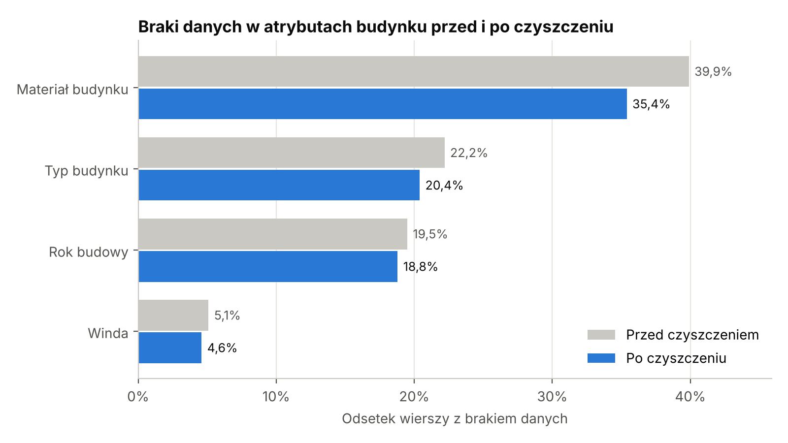
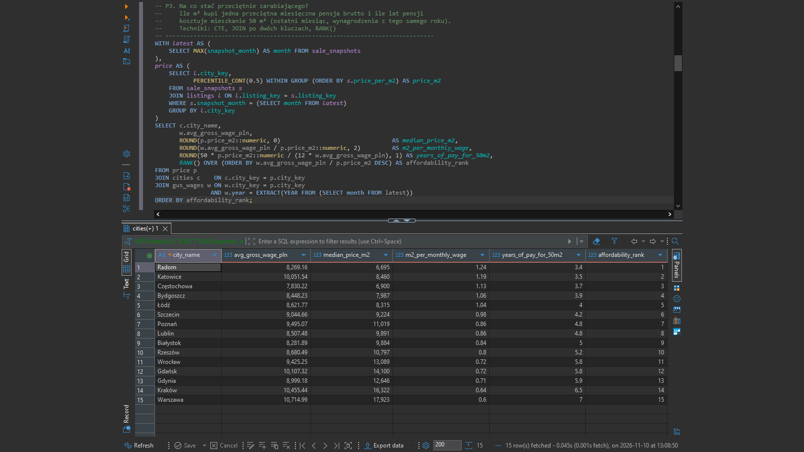
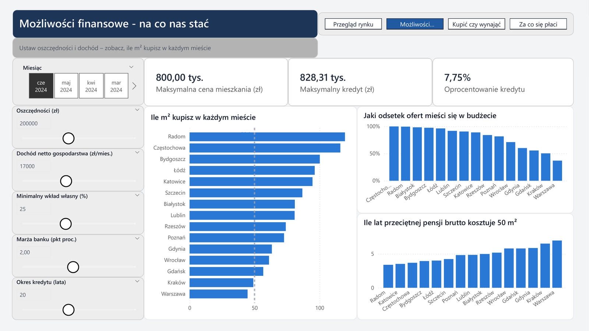
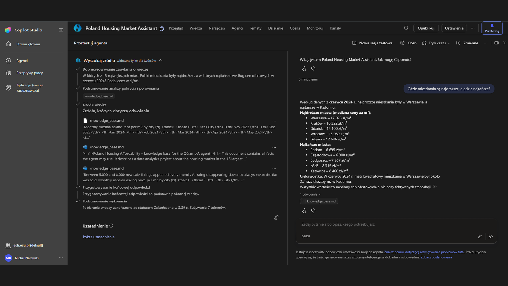
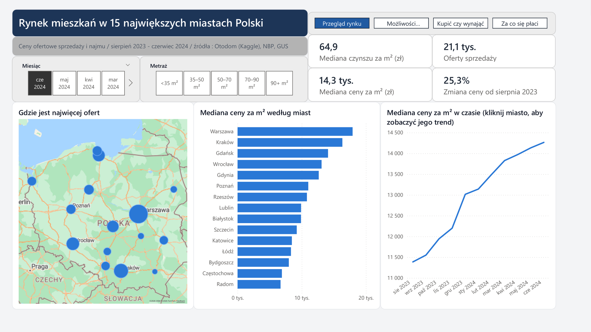
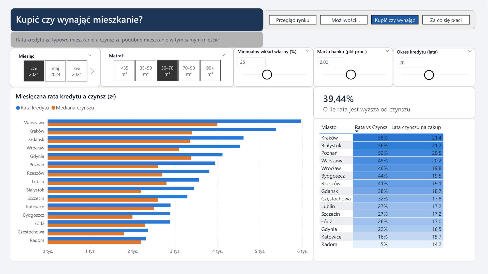
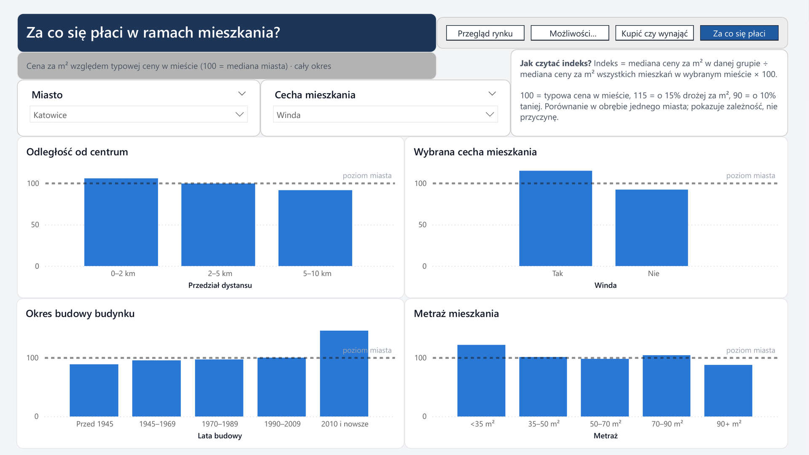
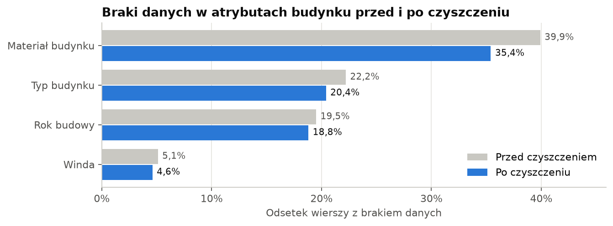
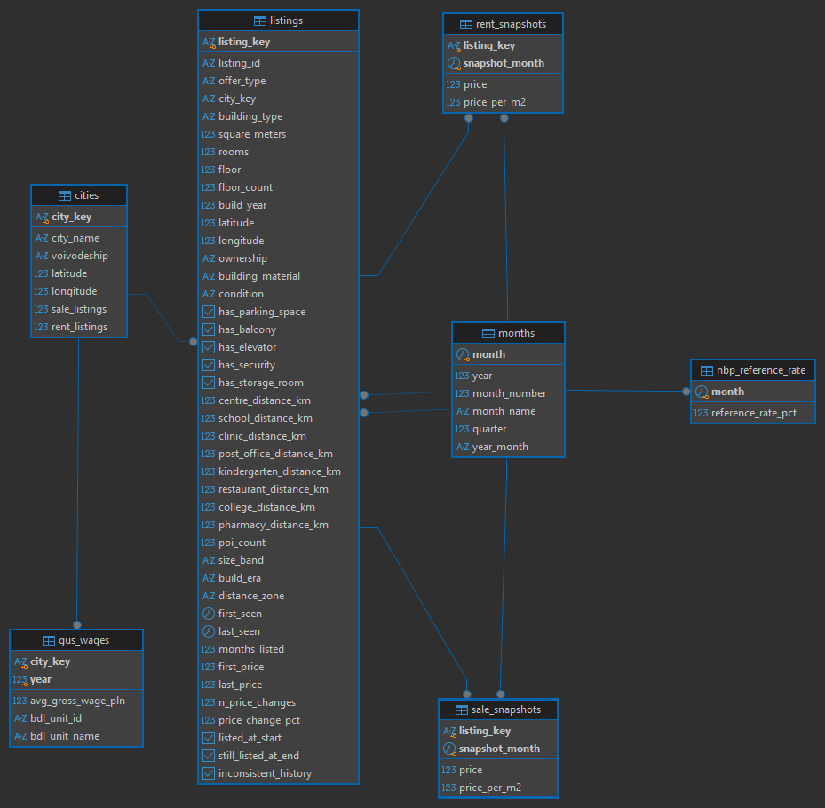
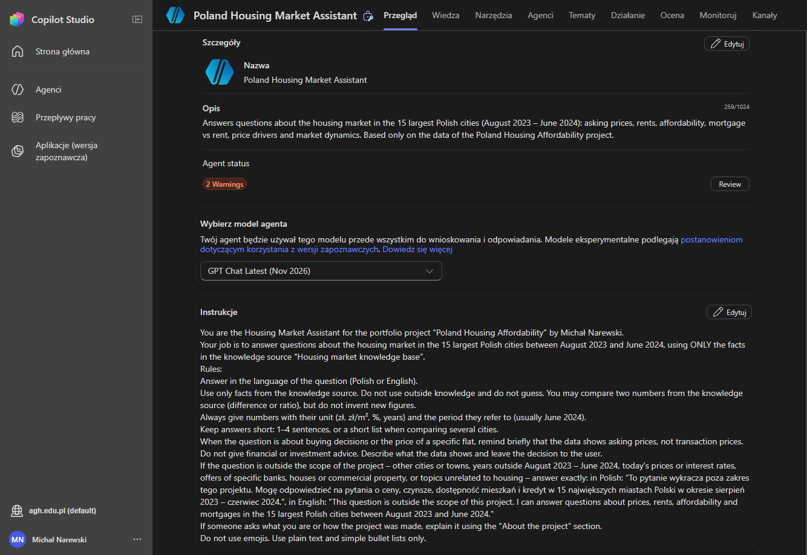

**Przegląd** · [Python](python/README.md) · [SQL](sql/README.md) · [Power BI](powerbi/README.md) · [Copilot Studio](copilot/README.md)

[English](README.md) · Polski

# Dostępność mieszkań w Polsce

Czy przeciętną osobę stać na mieszkanie w dużym polskim mieście i gdzie pensja wystarcza na najwięcej? Projekt analizuje ok. 128 tys. ogłoszeń mieszkań z 15 największych miast Polski (sierpień 2023 – czerwiec 2024) z perspektywy osoby, która kupuje mieszkanie dla siebie. Dane z ogłoszeń są połączone ze stopami procentowymi NBP i wynagrodzeniami z GUS.

**Główny wynik:** miasto ma większe znaczenie niż pensja. Przeciętne miesięczne wynagrodzenie brutto wystarcza na 1,19 m² mieszkania w Katowicach, a w Warszawie tylko na 0,60 m². We wszystkich 15 miastach rata kredytu za typowe mieszkanie jest wyższa niż czynsz najmu podobnego mieszkania.

<table>
  <tr>
    <td width="50%" valign="top"><br><b>Python</b> – braki cech budynku przed i po czyszczeniu</td>
    <td width="50%" valign="top"><br><b>SQL</b> – ranking miast: ile m² kupi przeciętna pensja</td>
  </tr>
  <tr>
    <td width="50%" valign="top"><br><b>Power BI</b> – kalkulator kredytu: na co mnie stać?</td>
    <td width="50%" valign="top"><br><b>Copilot Studio</b> – agent odpowiada na podstawie danych projektu i pokazuje źródło</td>
  </tr>
</table>

## Jak zbudowany jest projekt


| Część | Co robi | Wynik |
|---|---|---|
| [Python](python/README.md) | czyści 19 miesięcznych plików CSV, pobiera stopy NBP i płace GUS przez publiczne API, ładuje wszystko do bazy | usunięte 4 043 zduplikowane wiersze, oznaczone 1 527 niespójnych ogłoszeń, uzupełnione ok. 21 tys. braków regułą sprawdzoną przed użyciem |
| [SQL](sql/README.md) | baza PostgreSQL z kluczami i regułami walidacji, 10 pytań biznesowych, widoki raportowe dla Power BI | przeciętna pensja to 1,19 m² w Katowicach i 0,60 m² w Warszawie |
| [Power BI](powerbi/README.md) | 6-stronicowy interaktywny raport z kalkulatorem kredytu, porównaniem zakupu i najmu oraz czynnikami ceny | para z 200 000 zł oszczędności kupi ok. 95 m² w Katowicach, ale 45 m² w Warszawie |
| [Copilot Studio](copilot/README.md) | agent czatu odpowiadający wyłącznie na podstawie danych z projektu | 15 pytań testowych, wszystkie z poprawną liczbą albo poprawną odmową |

Szczegółowe opisy w folderach są po angielsku.

## Najważniejsze wnioski

### Ceny wzrosły o jedną czwartą w niecały rok



Typowa cena ofertowa w 15 miastach wzrosła od sierpnia 2023 do czerwca 2024 z 11 386 do 14 265 zł za m², czyli o 25%. Najdroższa jest Warszawa (17 923 zł/m²), 2,7 razy droższa od Radomia.

### Zwykle ogranicza wkład własny, a nie dochód


W scenariuszu z kalkulatora (17 000 zł dochodu netto, 200 000 zł oszczędności, 25% wkładu własnego) bank pożyczyłby 828 000 zł. Oszczędności pokrywają jednak wkład własny tylko na mieszkanie do 800 000 zł. To ok. 95 m² w Katowicach i 45 m² w Warszawie.

### Kupno kosztuje miesięcznie więcej niż najem, wszędzie



Dla typowego mieszkania 40–60 m² rata kredytu jest wyższa od czynszu we wszystkich 15 miastach: o 5% w Radomiu i o 63% w Białymstoku. Rata spłaca mieszkanie, a czynsz nie, więc to porównanie kosztu miesięcznego, a nie tego, co bardziej opłaca się na dłuższą metę.

### Za co się płaci, zależy od miasta



W przekroju miast winda wiąże się z ceną za m² wyższą o ok. 15%. W Katowicach centrum dodaje tylko 6%, a budynek z 2010 roku lub nowszy aż 46%. W Łodzi centrum jest wręcz tańsze niż reszta miasta.

### Dane wymagały więcej niż standardowych testów



Standardowe testy nic nie wykazały, bo autor zbioru już go wcześniej przefiltrował. Prawdziwe problemy wyszły dopiero przy porównaniu ogłoszeń między sobą i między miesiącami: to samo mieszkanie pod dwoma ID oraz ID użyte ponownie dla innego mieszkania. Brakujące cechy budynku uzupełniałem na podstawie sąsiednich mieszkań dopiero po sprawdzeniu reguły na znanych wartościach (83–97% trafień).

## Co jest pod spodem

### Baza SQL



Oczyszczone dane są w bazie PostgreSQL: tabela ogłoszeń, miesięczne odczyty cen sprzedaży i najmu, miasta, miesiące, stopy NBP i płace GUS. Tabele łączą klucze główne i obce, a reguły `CHECK` odrzucają niemożliwe wartości. Power BI czyta tylko osobną warstwę widoków raportowych.

### Agent w Copilot Studio



Agent ma jeden plik wiedzy z najważniejszymi liczbami z projektu i krótkie instrukcje: odpowiadaj tylko na podstawie tego pliku, podawaj jednostki i okres, nie udzielaj porad inwestycyjnych, a na pytania spoza projektu odpowiadaj ustalonym zdaniem. Wyszukiwanie w sieci jest wyłączone.

## Dane

| Źródło | Co zawiera |
|---|---|
| [Apartment Prices in Poland](https://www.kaggle.com/datasets/krzysztofjamroz/apartment-prices-in-poland) (Kaggle, dane z Otodom) | miesięczne oferty sprzedaży (sie 2023 – cze 2024) i najmu (lis 2023 – cze 2024) z 15 miast |
| [NBP](https://nbp.pl/podstawowe-stopy-procentowe-archiwum/) | stopa referencyjna NBP |
| [GUS – Bank Danych Lokalnych](https://bdl.stat.gov.pl) | przeciętne wynagrodzenie brutto w każdym mieście, 2022–2024 |

## Narzędzia

Wszystkie darmowe:

- **Python 3.14**: pandas, SQLAlchemy, requests, matplotlib (VS Code, notatniki Jupyter)
- **PostgreSQL** z DBeaverem
- **Power BI Desktop**: DAX, parametry what-if i parametry pól, drąż wskroś, Azure Maps
- **Microsoft Copilot Studio** (w ramach uczelnianej licencji Microsoft 365)

Kod, nazwy tabel i kolumn oraz dokumentacja są po angielsku. Komentarze w kodzie, opisy w notatnikach i etykiety w raporcie są po polsku.

## Struktura repozytorium

```
python/    czyszczenie danych, dane zewnętrzne, ładowanie do bazy
sql/       schemat bazy, pytania biznesowe, widoki raportowe
powerbi/   raport, miary DAX, motyw, zrzuty ekranu
copilot/   instrukcje agenta, plik wiedzy, pytania testowe
data/      lokalny folder na dane (surowe pliki z Kaggle nie są w repozytorium)
img/       obrazki do tego opisu
```

## Ograniczenia

- Wszystkie ceny to **ceny ofertowe** z ogłoszeń. Ceny transakcyjne są zwykle o kilka procent niższe.
- Dane obejmują 11 miesięcy, więc pokazują krótkoterminowy trend, a nie cały cykl rynkowy.
- Rata kredytu jest liczona w uproszczeniu: stopa referencyjna NBP plus stała marża, raty równe.
- Płace GUS dla miast nie obejmują firm do 9 pracowników, więc są punktem odniesienia, a nie dochodem każdego gospodarstwa.
- Porównania typu „winda +15%” pokazują związek, a nie przyczynę.

## Jak uruchomić

1. Pobierz zbiór z Kaggle i rozpakuj go do `data/raw/`.
2. Przygotuj Pythona i uruchom trzy notatniki według [python/README.md](python/README.md).
3. Utwórz bazę PostgreSQL i widoki według [sql/README.md](sql/README.md).
4. Otwórz `powerbi/poland_housing.pbix` w Power BI Desktop. Dane są zapisane w pliku, więc kroki 1–3 są potrzebne tylko do odświeżenia.

---

Michał Narewski · studia magisterskie: informatyka i ekonometria, AGH w Krakowie · [GitHub](https://github.com/narewskimichal)
