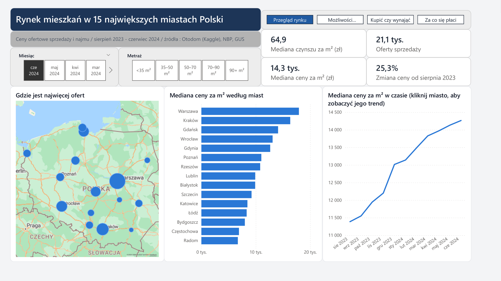
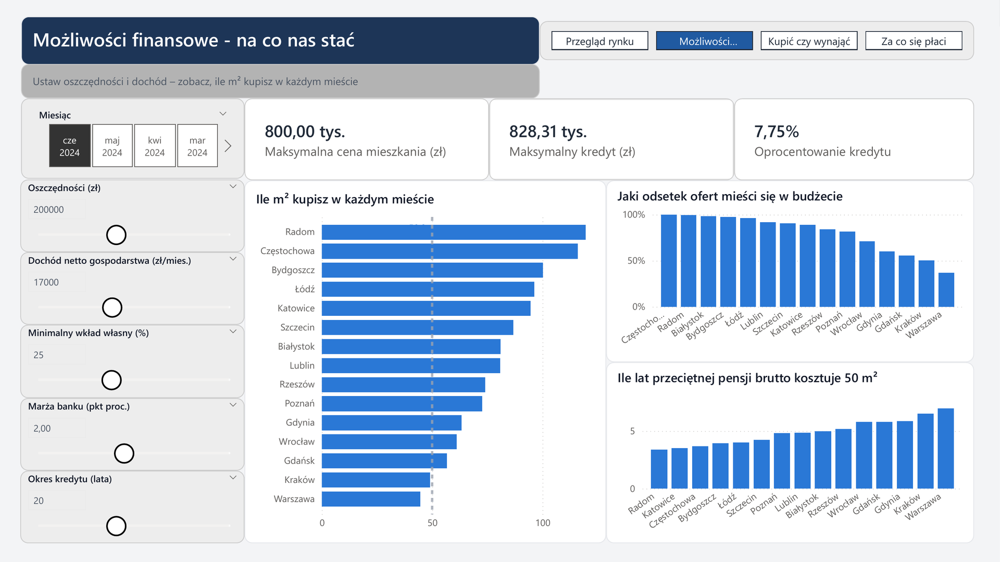
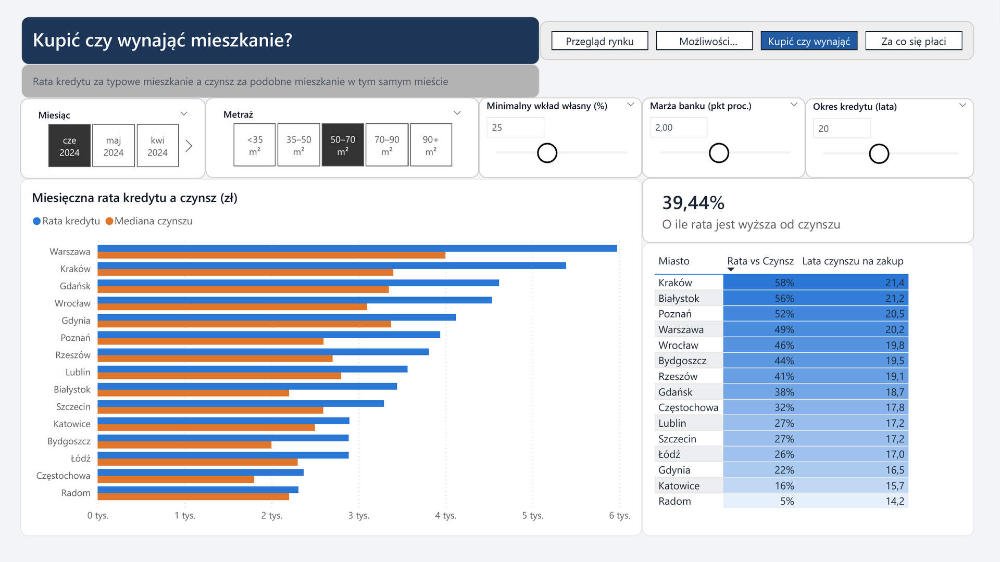
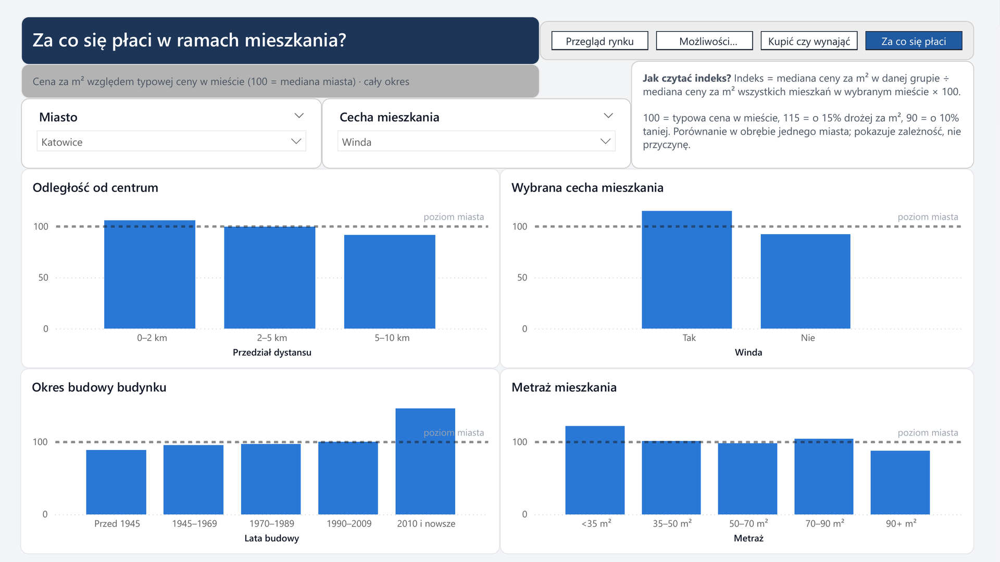
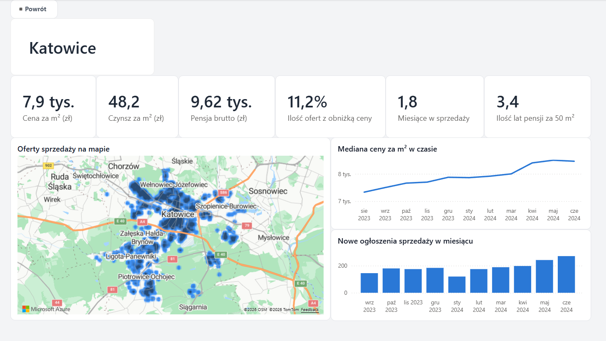
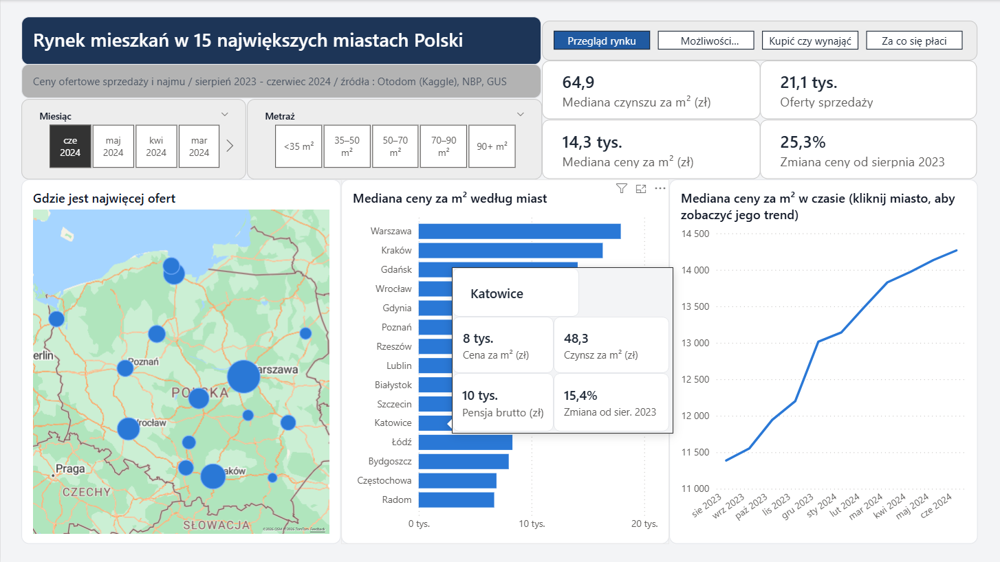

[Overview](../README.md) · [Python](../python/README.md) · [SQL](../sql/README.md) · **Power BI** · [Copilot Studio](../copilot/README.md)

# Power BI – housing affordability dashboard

An interactive report for someone who wants to buy a flat to live in: what the market looks like, what they can afford with their own savings and income, whether buying beats renting, and what drives the price per m².

**Main result:** a couple with 200,000 zł of savings and 17,000 zł of monthly net income can afford about 95 m² in Katowice but only 45 m² in Warsaw – and what limits them is the down payment, not the income.

The report reads the `reporting` views from PostgreSQL (see [SQL](../sql/README.md)). Labels in the report are in Polish.

## Report pages

### 1. Market overview

Typical asking prices in the 15 cities, where most offers are, and how prices moved over the year. The typical price per m² rose by 25% between August 2023 and June 2024. Clicking a city filters the trend to that city; hovering over it shows a small summary card.

### 2. What can I afford?

Five sliders – savings, net income, down payment, bank margin and loan term – drive a mortgage calculation. The maximum loan assumes the instalment can take up to 40% of net income (a typical limit in Polish banks). The maximum price is the lower of two limits: loan plus savings, and the price your savings can cover as a down payment. The charts show how many m² that buys in each city and what share of offers fits the budget. In the scenario on the screenshot (25% down payment, 20-year loan) the bank would lend 828,000 zł, but 200,000 zł of savings only covers the down payment on a flat up to 800,000 zł.

### 3. Buy or rent?

The monthly mortgage payment for a typical flat compared with the rent of a similar flat in the same city. The interest rate is the NBP reference rate of the selected month plus the bank margin. In every city the payment is higher than rent; the gap is smallest in Radom and Katowice and largest in Kraków and Białystok.

### 4. What do you pay for?

Price per m² compared with the typical price in the chosen city (100 = city median), by distance from the centre, building age, flat size and a chosen feature (elevator, parking space, balcony, storage room, school and kindergarten nearby). In Katowice (on the screenshot) the centre adds only about 6% to the price per m², while a building from 2010 or later adds 46% and an elevator 15%.

### 5. City details (drill-through)

Right-clicking a city on a chart opens its details: key numbers, a heat map of all sale offers in the city, the price trend and new listings per month.

### 6. Tooltip

Hovering over a city on the map or the bar chart shows a summary card instead of the default tooltip.

## Data model

Star schema built from the SQL views: three fact tables (`fact_sale_price`, `fact_rent_price`, `fact_city_wage`) and three dimensions (`dim_listing`, `dim_city`, `dim_month`), all one-to-many with single-direction filtering.

On top of it:

- **26 DAX measures** in a separate measures table, grouped in display folders – all of them in [`measures.dax`](measures.dax) with comments,
- **5 what-if parameters** for the mortgage calculation,
- **1 field parameter** that switches the flat feature on page 4,

A few measures worth a look:

| Measure | What it does |
|---|---|
| `Max Loan` | present value of the highest instalment the bank would accept (annual formula) |
| `Max Budget` | lower of the income limit and the down-payment limit |
| `Monthly Payment` | instalment for the typical flat in the current selection |
| `Price Index vs City` | median price per m² of a group divided by the city median, ignoring filters on flat attributes |
| `Price Change MoM %`, `Price Change Since Start %` | time comparisons written by hand, because the data is monthly |
| `Price Cut Share %` | share of listings whose price went down, only for listings with a known start and a consistent history |

## Files

| File | What it is |
|---|---|
| `poland_housing.pbix` | the report |
| `poland_housing.pdf` | PDF export of the main pages |
| [`measures.dax`](measures.dax) | all DAX measures with comments |
| `img/` | screenshots |

## Limitations

- Asking prices, not transaction prices – real prices are usually a few percent lower.
- The mortgage rate is simplified to the NBP reference rate plus a margin; real offers depend on the bank and the borrower.
- GUS wages at city level exclude companies with up to 9 employees, so they are a reference point, not the income of every household.
- Distances are straight-line distances, not travel times.

## How to open

Open `poland_housing.pbix` in Power BI Desktop. The data is stored in the file, so the report works without the database. To refresh it, you need the PostgreSQL database from the [SQL](../sql/README.md) part.
