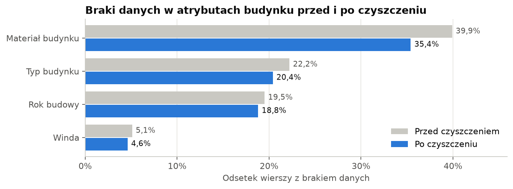

[Overview](../README.md) · **Python** · [SQL](../sql/README.md) · [Power BI](../powerbi/README.md) · [Copilot Studio](../copilot/README.md)

# Python – data cleaning and external data

This part turns monthly CSV snapshots of apartment listings into clean tables ready for the database, and adds two public data sources: NBP interest rates and GUS wages.

**Main result:** 4,043 duplicate rows (the same flat posted under two IDs) removed, 1,527 listings with an inconsistent history flagged, and about 21,000 missing building attributes recovered – using a rule that was tested before it was applied.

## Data

| Source | What it contains |
|---|---|
| [Apartment Prices in Poland](https://www.kaggle.com/datasets/krzysztofjamroz/apartment-prices-in-poland) (Kaggle, scraped from Otodom) | 11 monthly files of sale offers (Aug 2023 – Jun 2024) and 8 of rent offers (Nov 2023 – Jun 2024) from the 15 largest Polish cities: 266,415 rows, 28 columns – price, area, rooms, floor, build year, coordinates, distances to schools, shops etc. |
| [NBP](https://nbp.pl/podstawowe-stopy-procentowe-archiwum/) – interest rate archive (XML) | every change of the NBP reference rate, turned into a monthly average |
| [GUS – Local Data Bank (BDL)](https://bdl.stat.gov.pl) – public API | average monthly gross wage in each of the 15 cities, 2022–2024 |

## What I did

### 1. Standard checks – and why they were not enough

The usual checks (identical rows, impossible values like a 20th floor in a 4-floor building, prices outside sensible limits or extreme for their own city) all came back clean. The dataset author had already filtered it. The checks stay in the pipeline anyway, because they document that the data was verified.

The real problems only show up when listings are compared **with each other** and **across months**.

### 2. The same flat under two IDs

Agencies often post the same flat separately. Two rows are treated as one offer when, in the same month, they have exactly the same coordinates, area, floor, number of rooms and price. **4,043 rows removed**, which means 2,300 double listings fewer.

### 3. Listings that change between months

A listing's area, location and number of rooms should stay the same. **1,527 listings** change their area by more than 10%, move by more than 1 km or change the number of rooms – usually an ID reused for a different flat. They are kept but flagged (`inconsistent_history`), so they can be excluded from price-history analysis.

### 4. Filling missing values – after testing the rule

Building attributes are often missing (building material in 40% of rows). Two ways to recover them without guessing:

- **from other months of the same listing** – if all known values agree (1,881 values),
- **from other flats in the same building** – listings at exactly the same coordinates, where at least 2 neighbours know the value and all agree (19,137 values).

Before using the building rule I tested it: 10% of the *known* values were hidden, filled with the rule and compared with the truth.

| Attribute | Filled correctly |
|---|---|
| Building material | 97% |
| Elevator | 93% |
| Building type | 92% |
| Build year | 83% exact, 91% within 2 years |



Missing building material dropped from 39.9% to 35.4% and building type from 22.2% to 20.4%. Flat-level fields (floor, condition) cannot be taken from neighbours, so they were left as they are.

### 5. Output tables

| Table | Rows | One row = |
|---|---|---|
| `listings` | 128,608 | one flat: latest description, size / age / distance bands, listing history, quality flags |
| `sale_snapshots` | 192,356 | asking price of a flat in a month |
| `rent_snapshots` | 70,016 | asking rent of a flat in a month |
| `cities` | 15 | city with Polish name and voivodeship |
| `nbp_reference_rate` | monthly | average NBP reference rate |
| `gus_wages` | 45 | average gross wage per city and year |

## Files

| File | What it does |
|---|---|
| [`01_data_cleaning.ipynb`](01_data_cleaning.ipynb) | runs the whole cleaning step by step and shows what changed |
| [`02_external_data.ipynb`](02_external_data.ipynb) | downloads NBP rates and GUS wages through their public APIs |
| [`03_load_to_postgres.ipynb`](03_load_to_postgres.ipynb) | loads all tables into PostgreSQL (one transaction, `COPY`) and checks row counts |
| [`clean.py`](clean.py), [`external.py`](external.py), [`load_db.py`](load_db.py) | the logic behind the notebooks |

Comments and notebook descriptions are in Polish; code and names are in English.

## Limitations

- Prices are **asking prices** from listings, not transaction prices.
- The data covers 11 months, so it shows short-term trends, not a full market cycle.
- Coordinates are sometimes street-level rather than building-level, which is why the building rule only fills values when at most 30 listings share a point.

## How to run

Python 3.14, a virtual environment and the packages from `requirements.txt`:

```
python -m venv .venv
.venv\Scripts\activate
pip install -r requirements.txt
```

1. Download the dataset from Kaggle and unzip the CSV files to `data/raw/`.
2. Run `01_data_cleaning.ipynb`, then `02_external_data.ipynb`.
3. Create the database with [`sql/schema.sql`](../sql/schema.sql), then run `03_load_to_postgres.ipynb`.
