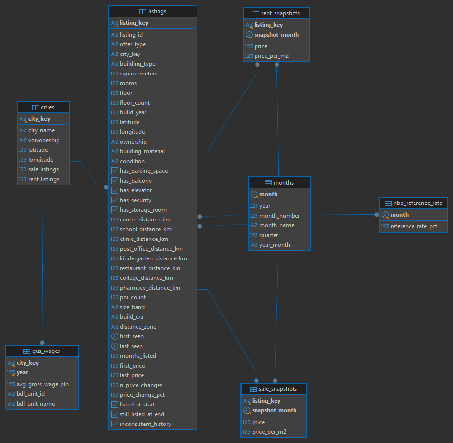

[Overview](../README.md) · [Python](../python/README.md) · **SQL** · [Power BI](../powerbi/README.md) · [Copilot Studio](../copilot/README.md)

# SQL – database, business questions and reporting layer

The cleaned data lives in a PostgreSQL database with primary and foreign keys and validation rules. On top of it there are 10 business questions answered in SQL and a set of views that Power BI reads.

**Main result:** an average monthly gross salary buys 1.19 m² of a flat in Katowice but only 0.60 m² in Warsaw – a 50 m² flat costs 3.5 vs 7.0 years of gross pay.

## Data model

| Table | What it holds |
|---|---|
| `listings` | one row per flat – description, location quality, listing history, quality flags |
| `sale_snapshots`, `rent_snapshots` | price of every flat in every month |
| `cities` | the 15 cities |
| `months` | calendar months, shared by all time-based tables |
| `nbp_reference_rate` | NBP reference rate, monthly average |
| `gus_wages` | average gross wage per city and year |

Every table has a primary key, the relationships are enforced with foreign keys, and `CHECK` rules reject impossible values (e.g. negative prices, floor below 0, a sale snapshot pointing to a rent listing). The full definition is in [`schema.sql`](schema.sql).

## Business questions

All in [`queries.sql`](queries.sql). The point of view is a private buyer looking for a flat to live in. "Typical price" means the median, because a few luxury flats would distort the average.

| # | Question | Answer (June 2024 unless stated) | Techniques |
|---|---|---|---|
| 1 | Where are flats cheapest and most expensive? | Warsaw 17,923 zł/m², Radom 6,695 zł/m² – 2.7× difference. Rents: 79 vs 39 zł/m² | CTE, JOIN, median, `RANK()` |
| 2 | How did prices change over the year? | Kraków +25%, Warsaw +22%, Radom +9% (Aug 2023 → Jun 2024) | `LAG()`, `FIRST_VALUE()` |
| 3 | What can an average salary buy? | 1.24 m² in Radom, 1.19 in Katowice, 0.60 in Warsaw | join on two keys, `RANK()` |
| 4 | Buy or rent? | Mortgage payment for a 40–60 m² flat is higher than rent everywhere: +5% in Radom up to +63% in Białystok | chained CTEs, annuity formula, join to NBP rates |
| 5 | How much more does the centre cost? | Up to 2 km from the centre: +25% in Warsaw and Gdańsk, +22% in Kraków – but in Łódź and Szczecin the centre is cheaper | two-level aggregation |
| 6 | What does an elevator, parking space or balcony add? | Elevator +15% per m² (median across cities), parking +4%, balcony +2% | `CROSS JOIN LATERAL`, `FILTER` |
| 7 | New or old building? | Buildings from 2010 or later: index 114 (city = 100), 1970–1989 blocks: 92 | price index, `SUM() OVER ()` |
| 8 | Is there a school and a kindergarten nearby? | Within 500 m for 90% of offers in Radom, 37% in Gdynia | conditional aggregation |
| 9 | How often do sellers cut prices? | 9% of listings in Kraków, 19% in Radom; the average cut is about 5% | data-quality flags in `WHERE` |
| 10 | Is supply growing? | 5–8 thousand new sale listings every month | running total `SUM() OVER (ORDER BY)` |

Comparisons in questions 5–7 are made **within each city**, so Warsaw prices do not distort the result. They show association and not the cause – for example new buildings are also more likely to have an elevator.

## Reporting layer for Power BI

[`views.sql`](views.sql) creates the schema `reporting` with 6 views arranged as a star schema:

- facts: `fact_sale_price`, `fact_rent_price`, `fact_city_wage`
- dimensions: `dim_listing`, `dim_city`, `dim_month`

Power BI reads only these views, never the base tables. The views also translate the values shown in the report into Polish (e.g. `Block of flats` → `Blok`) and add sort-order columns, so the database and the Python code can stay in English.

## Files

| File | What it does |
|---|---|
| [`schema.sql`](schema.sql) | creates all tables with keys and rules (drops existing ones – data included) |
| [`queries.sql`](queries.sql) | 10 business questions |
| [`views.sql`](views.sql) | reporting views for Power BI (safe to re-run) |
| `img/schema_diagram.png` | diagram generated in DBeaver |

Comments are in Polish; table, column and alias names are in English.

## How to run

PostgreSQL (I used DBeaver as the client).

1. Create a database called `housing`.
2. Run `schema.sql`.
3. Load the data with [`python/03_load_to_postgres.ipynb`](../python/03_load_to_postgres.ipynb).
4. Run `views.sql`, then any query from `queries.sql`.
